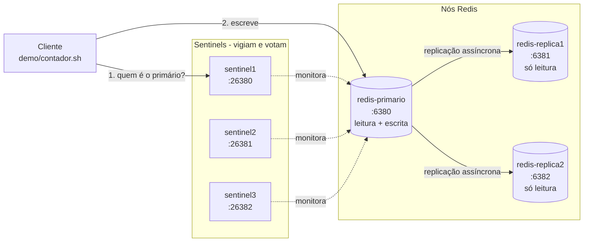

# Redis com replicação e failover automático (Sentinel)

Tutorial da disciplina de Sistemas Distribuídos e de Tempo Real. Reserva do tema: [issue #26](https://github.com/joaoepj2/sistemas-distribuidos-tempo-real/issues/26).

| | |
| --- | --- |
| **Software** | Redis 7.4.2 (imagem `redis:7.4.2-alpine`) com Redis Sentinel |
| **Problema distribuído** | Cache e dados em memória replicados, com troca automática de primário quando ele cai |
| **Nós** | 1 primário, 2 réplicas, 3 Sentinels (6 contêineres) |
| **Tempo de demonstração** | 15 minutos ([roteiro-demo.md](roteiro-demo.md)) |
| **Testado em** | 10/11/2026, Docker Desktop 4.99 no macOS (Intel): 6 contêineres saudáveis e failover verificado (seção 7) |
| **Autora** | Rivane Martins Gimenez ([@rivanemartins-gif](https://github.com/rivanemartins-gif)) |

---

## 1. Visão geral

### Que problema o Redis resolve

O Redis é um banco de dados **em memória**, do tipo chave-valor. Como os dados ficam na RAM, uma leitura leva menos de 1 milissegundo. Por isso ele é usado como **cache** na frente de bancos mais lentos, para guardar **sessões de login**, **filas simples**, **contadores** e **rankings**.

O problema de sistemas distribuídos aparece quando há **um único servidor Redis**: se ele cair, toda a aplicação que depende dele cai junto. É um **ponto único de falha**. Este tutorial resolve isso com duas peças:

1. **Replicação:** o primário copia cada escrita para duas réplicas. As réplicas aceitam leitura, mas não escrita.
2. **Sentinel:** três processos vigiam o primário. Se ele parar de responder, eles **votam**, escolhem uma réplica e a **promovem a novo primário**, sem intervenção humana. As outras réplicas passam a copiar o novo primário.

### Arquitetura da demonstração



O cliente **não guarda o endereço do primário**: a cada operação ele pergunta a um Sentinel quem é o primário atual. É assim que ele continua funcionando depois de uma troca.

### Alternativas e quando não usar

| Opção | Quando faz sentido |
| --- | --- |
| **Redis + Sentinel** (este tutorial) | Os dados cabem em um servidor e o objetivo é alta disponibilidade |
| **Redis Cluster** | Os dados não cabem em um servidor e precisam ser divididos (*sharding*) entre vários primários |
| **Valkey** | Cópia do Redis mantida pela Linux Foundation, com licença BSD. Os comandos deste tutorial funcionam igual; basta trocar a imagem para `valkey/valkey` |
| **Memcached** | Só cache simples, sem replicação nem persistência |

**Quando não usar o Redis:** como banco principal de dados que não podem ser perdidos. A replicação é **assíncrona**: o primário confirma a escrita ao cliente **antes** de copiá-la para as réplicas. Se ele cair nesse intervalo, a escrita se perde. Para dinheiro, pedidos e cadastros, use um banco relacional com transações.

---

## 2. Conceitos mínimos

| Termo | Significado |
| --- | --- |
| **Chave-valor** | Modelo de dados: cada valor é guardado e buscado por um nome único (`SET aluno:1 "Ana"`, `GET aluno:1`) |
| **Primário** (*master*) | O único nó que aceita escritas |
| **Réplica** (*replica*, antes chamada *slave*) | Cópia do primário, somente leitura. Pode ser promovida a primário |
| **Replicação assíncrona** | O primário responde ao cliente primeiro e envia a cópia às réplicas depois. É rápida, mas pode perder as últimas escritas numa queda |
| **Sentinel** | Processo separado que vigia o primário, avisa os clientes de quem é o primário atual e conduz o failover |
| **Quórum** | Número mínimo de Sentinels que precisam concordar que o primário caiu. Aqui são 2 de 3 |
| **SDOWN / ODOWN** | *Subjectively down*: um Sentinel acha que o primário caiu. *Objectively down*: o quórum concorda e o failover começa |
| **Failover** | Promoção automática de uma réplica a primário, com as demais réplicas reapontadas para ela |

---

## 3. Pré-requisitos

| Item | Requisito |
| --- | --- |
| Sistema operacional | Linux (referência), Windows 10/11 com WSL2 ou macOS |
| Docker | Docker Engine 24+ ou Docker Desktop, com o Compose v2 (`docker compose version`) |
| Memória | Cerca de **50 MB** para os 6 processos com poucos dados (cerca de 8 MB cada). É o mais leve dos temas da disciplina |
| Disco | Cerca de 40 MB para a imagem `redis:7.4.2-alpine`, mais os volumes |
| Rede | Internet só para baixar a imagem na primeira vez |

### Portas expostas

Todas usam números altos, para não conflitar com um Redis que já exista na máquina (porta 6379).

| Contêiner | Porta na sua máquina | Porta no contêiner | Função |
| --- | --- | --- | --- |
| redis-primario | 6380 | 6379 | Redis (primário no início) |
| redis-replica1 | 6381 | 6379 | Redis (réplica) |
| redis-replica2 | 6382 | 6379 | Redis (réplica) |
| sentinel1 | 26380 | 26379 | Sentinel |
| sentinel2 | 26381 | 26379 | Sentinel |
| sentinel3 | 26382 | 26379 | Sentinel |

---

## 4. Instalação

### Estrutura da pasta

```
tutoriais/cache/redis/
├── README.md                      # este tutorial
├── docker-compose.yml             # os 6 contêineres
├── .env.example                   # versão da imagem e senha de laboratório
├── roteiro-demo.md                # roteiro de 15 minutos para a aula
├── sentinel/
│   ├── sentinel.conf.template     # configuração comentada do Sentinel
│   └── entrypoint.sh              # gera o sentinel.conf e inicia o Sentinel
├── demo/
│   └── contador.sh                # cliente que escreve 1 vez por segundo
└── imagens/
```

### Subir o ambiente

```bash
# 1. Entrar na pasta do tutorial
cd tutoriais/cache/redis

# 2. Criar o arquivo de variáveis a partir do exemplo
cp .env.example .env

# 3. Baixar a imagem antes da aula (plano B: não depender da rede da sala)
docker compose pull

# 4. Subir tudo em segundo plano
docker compose up -d
```

### Verificar

```bash
docker compose ps
```

Saída esperada: os 6 contêineres com `STATUS` igual a `Up ... (healthy)`. Os Sentinels só sobem depois que o primário fica saudável, então podem levar uns 10 segundos.

```
NAME             SERVICE          STATUS
redis-primario   redis-primario   Up 20 seconds (healthy)
redis-replica1   redis-replica1   Up 15 seconds (healthy)
redis-replica2   redis-replica2   Up 15 seconds (healthy)
sentinel1        sentinel1        Up 10 seconds (healthy)
sentinel2        sentinel2        Up 10 seconds (healthy)
sentinel3        sentinel3        Up 10 seconds (healthy)
```

> **Para facilitar os próximos comandos**, defina um atalho no terminal com a senha do `.env`:
> ```bash
> export REDISCLI_AUTH=sdtr-lab-2026
> ```
> O `redis-cli` lê essa variável e não pede `-a <senha>` a cada comando. Dentro dos contêineres a senha é passada com `-a`.

### Reiniciar do zero

```bash
docker compose down -v && docker compose up -d
```

O `-v` apaga os volumes: os dados e a memória dos Sentinels sobre quem é o primário. Use antes de cada ensaio da demonstração.

---

## 5. Configuração

### `.env.example`

```ini
REDIS_IMAGE=redis:7.4.2-alpine     # versão fixa, nunca "latest"
REDIS_PASSWORD=sdtr-lab-2026       # senha de LABORATÓRIO
SENTINEL_MASTER_NAME=mymaster      # nome lógico do grupo vigiado
```

### Nós Redis (`docker-compose.yml`)

O primário e as réplicas usam a mesma imagem. Só muda o comando de inicialização:

```yaml
command: >
  redis-server --port 6379
  --requirepass ${REDIS_PASSWORD}       # senha para clientes
  --masterauth ${REDIS_PASSWORD}        # senha usada ao copiar de um primário
  --appendonly yes                      # grava cada escrita em disco (AOF)
  --replica-announce-ip redis-replica1  # se anuncia pelo NOME, não pelo IP
  --replicaof redis-primario 6379       # SÓ nas réplicas: "copie deste primário"
```

Por que cada opção existe:

- **`--masterauth` também no primário.** Depois de um failover, o antigo primário vira réplica e precisa da senha para copiar do novo primário. Sem ela, ele fica parado em `master_link_status:down`.
- **`--appendonly yes`.** Sem persistência, um nó que reinicia volta vazio. Se esse nó for o primário, ele **replica o vazio** para todas as réplicas e o dado se perde em todos os nós.
- **`--replica-announce-ip <nome>`.** O Docker pode dar um IP diferente ao contêiner a cada reinício. Anunciando pelo nome, o Sentinel sempre encontra o nó.

### Sentinel (`sentinel/sentinel.conf.template`)

```ini
port 26379
sentinel resolve-hostnames yes      # aceita nomes (redis-primario) em vez de IPs
sentinel announce-hostnames yes     # informa nomes, não IPs, aos clientes
sentinel announce-ip sentinel1      # como este Sentinel se apresenta aos outros

sentinel monitor mymaster redis-primario 6379 2   # vigia o primário, quórum 2
sentinel auth-pass mymaster <senha>               # senha dos nós Redis
sentinel down-after-milliseconds mymaster 5000    # 5 s sem resposta = suspeito
sentinel failover-timeout mymaster 15000          # limite de um failover
sentinel parallel-syncs mymaster 1                # réplicas ressincronizando por vez
```

**O que mudar e por quê:**

- **Quórum (`2`).** Com 3 Sentinels, quórum 2 tolera um Sentinel fora do ar. Quórum 1 deixaria um único Sentinel com problema de rede disparar um failover sozinho.
- **`down-after-milliseconds`.** 5 segundos deixa a demonstração rápida. Em produção use cerca de 30 segundos, para que uma lentidão passageira não cause uma troca de primário desnecessária.
- **Por que 3 Sentinels e não 1.** Um único Sentinel seria um novo ponto único de falha, e também não teria como saber se o problema está no primário ou na própria rede dele.

O `sentinel/entrypoint.sh` existe porque **o Sentinel exige um arquivo de configuração gravável**: ele reescreve o arquivo sozinho depois de cada failover, registrando o novo primário. O script copia o modelo para o volume `/data` **somente na primeira subida** e troca os marcadores pelos valores do `.env`.

---

## 6. Demonstração

O roteiro completo, com tempos, saídas esperadas e plano B, está em **[roteiro-demo.md](roteiro-demo.md)**. Resumo dos três atos:

| Ato | Tempo | O que acontece |
| --- | --- | --- |
| Subir | 3 min | `docker compose up -d` e `ps` com os 6 contêineres saudáveis |
| Funcionar | 7 min | Escrita no primário lida nas réplicas, réplica recusando escrita, colegas escrevendo e lendo a partir do próprio notebook |
| Falhar | 5 min | Contador escrevendo sem parar, primário derrubado, Sentinels elegendo outro primário e contador continuando |

### Comandos principais

```bash
# Quem é o primário agora? (pergunta ao Sentinel)
docker compose exec sentinel1 redis-cli -p 26379 SENTINEL get-master-addr-by-name mymaster

# Escrever no primário
docker compose exec redis-primario redis-cli -a sdtr-lab-2026 --no-auth-warning SET aula:tema "Redis Sentinel"

# Ler na réplica (o dado já foi copiado)
docker compose exec redis-replica1 redis-cli -a sdtr-lab-2026 --no-auth-warning GET aula:tema

# Tentar escrever na réplica (deve ser recusado)
docker compose exec redis-replica1 redis-cli -a sdtr-lab-2026 --no-auth-warning SET x 1
# (error) READONLY You can't write against a read only replica.
```

### Participação da turma

Os colegas acessam o seu Redis pela rede da sala, usando o IP do seu notebook (`ip addr` no Linux, `ipconfig` no Windows):

```bash
# No notebook do colega (precisa do redis-cli ou de um contêiner redis)
docker run --rm -it redis:7.4.2-alpine redis-cli -h <IP-DA-APRESENTADORA> -p 6380 -a sdtr-lab-2026 SET colega:<nome> "presente"
docker run --rm -it redis:7.4.2-alpine redis-cli -h <IP-DA-APRESENTADORA> -p 6381 -a sdtr-lab-2026 GET colega:<nome>
```

O colega escreve no primário (porta 6380) e lê o próprio dado na réplica (porta 6381).

---

## 7. Verificação e teste de falhas

### Verificar a replicação

```bash
docker compose exec redis-primario redis-cli -a sdtr-lab-2026 --no-auth-warning INFO replication
```

Saída esperada (trecho):

```
role:master
connected_slaves:2
slave0:ip=redis-replica1,port=6379,state=online,offset=865,lag=1
slave1:ip=redis-replica2,port=6379,state=online,offset=865,lag=1
```

`state=online` e o mesmo `offset` nas duas réplicas indicam que elas estão em dia.

### Verificar os Sentinels

```bash
docker compose exec sentinel1 redis-cli -p 26379 SENTINEL master mymaster
```

Procure na saída: `flags` = `master`, `num-slaves` = `2`, `num-other-sentinels` = `2` e `quorum` = `2`.

### Teste de falha 1: derrubar o primário (failover)

Terminal 1, com o cliente escrevendo uma vez por segundo:

```bash
docker compose exec sentinel1 sh /demo/contador.sh
```

Terminal 2:

```bash
docker compose stop redis-primario
```

Resultado obtido no teste (10/11/2026, Docker Desktop no macOS):

```
21:20:39  primário=redis-primario  contador=8
21:20:40  primário=redis-primario  contador=9
21:20:42  primário=redis-primario  ERRO: Error: Server closed the connection
21:20:43  primário=redis-primario  ERRO: Could not connect to Redis at redis-primario:6379: Name has no usable address
   ... (6 segundos de erro, até 21:20:47)
21:20:48  primário=redis-replica1  contador=10
21:20:49  primário=redis-replica1  contador=11
```

A réplica promovida pode ser `redis-replica1` ou `redis-replica2`: o Sentinel escolhe a que estiver mais atualizada, e no empate a escolha varia a cada execução.

O que aconteceu, segundo os logs dos Sentinels (`docker compose logs sentinel1 sentinel2 sentinel3`):

```
+sdown master mymaster redis-primario 6379            ← um Sentinel suspeita (5 s sem resposta)
+odown master mymaster redis-primario 6379 #quorum 2/2 ← 2 Sentinels concordam
+elected-leader master mymaster ...                    ← um Sentinel é eleito para conduzir
+selected-slave slave redis-replica1:6379 ...          ← escolhe a réplica a promover
+switch-master mymaster redis-primario 6379 redis-replica1 6379  ← novo primário
```

**Leituras importantes:**
- O contador continuou do 10, logo depois do 9. **Nenhuma escrita confirmada foi perdida**, porque as réplicas estavam em dia.
- O sistema ficou **cerca de 7 segundos sem aceitar escritas**: os 5 segundos de `down-after-milliseconds` mais o tempo da votação. Esse é o preço da disponibilidade automática.
- O cliente não precisou ser alterado: ele perguntou ao Sentinel e passou a escrever no novo primário.

### Teste de falha 2: o antigo primário volta

```bash
docker compose start redis-primario
docker compose exec redis-primario redis-cli -a sdtr-lab-2026 --no-auth-warning ROLE
```

Resultado obtido no teste:

```
t=2s   papel do antigo primário: master
...
t=10s  papel do antigo primário: master
t=12s  papel do antigo primário: slave     ← o Sentinel o rebaixou a réplica
```

Log do Sentinel: `+convert-to-slave slave redis-primario:6379 ... @ mymaster <novo primário> 6379`.

**Este é o ponto mais interessante para a turma.** Por cerca de 10 segundos existiram **dois nós se dizendo primário**, situação conhecida como *split-brain*. Um cliente que escrevesse direto no `redis-primario` (porta 6380), sem perguntar ao Sentinel, gravaria num nó desatualizado, e essa escrita seria **apagada** quando ele virasse réplica. Por isso a aplicação deve sempre descobrir o primário pelo Sentinel.

### Teste de falha 3: derrubar um Sentinel

```bash
docker compose stop sentinel3
docker compose stop redis-replica2      # supondo que redis-replica2 seja o primário atual
```

Com 2 Sentinels de pé, o quórum (2) ainda é atingido e o failover acontece normalmente. Se você derrubar **dois** Sentinels, o failover **não acontece**: um Sentinel sozinho não tem maioria para decidir.

---

## 8. Problemas comuns

Problemas tratados na montagem do ambiente. A configuração foi desenhada para evitar cada um deles; a tabela mostra o sintoma, caso alguém altere os arquivos.

| Sintoma | Causa | Correção |
| --- | --- | --- |
| Sentinel encerra logo ao subir com erro de configuração ou permissão | O Sentinel exige um arquivo de configuração **gravável**, e um arquivo montado como `:ro` não pode ser reescrito | O `entrypoint.sh` copia o modelo para o volume `/data` e o Sentinel usa a cópia |
| `Can't resolve instance hostname` nos logs do Sentinel | Por padrão o Sentinel só aceita IPs | `sentinel resolve-hostnames yes` e `sentinel announce-hostnames yes` |
| Depois de reiniciar, o Sentinel volta a vigiar o primário antigo | O `sentinel.conf` foi recriado a partir do modelo | O script só gera o arquivo se ele **não existir**. Para recomeçar de verdade, use `docker compose down -v` |
| O antigo primário volta e fica com `master_link_status:down` | Faltou `--masterauth` no primário original | Já incluído no Compose: todos os nós têm `--masterauth` |
| `contador.sh` trava por muito tempo durante o failover | O `redis-cli` espera a conexão com um nó que não responde | O script usa `timeout 2` em cada escrita |
| `exec /usr/local/bin/sentinel-entrypoint.sh: no such file or directory` no Windows | O arquivo `.sh` foi salvo com quebra de linha do Windows (CRLF) | O repositório já força LF (`.gitattributes`). Se editar no Windows, salve como **LF** no VS Code (canto inferior direito) |
| Fora do Docker, o cliente recebe `redis-replica2` do Sentinel e não consegue conectar | Os nomes dos contêineres só existem na rede Docker, não na sua máquina | Rode clientes **dentro** da rede (`docker compose exec ...`) ou use as portas publicadas (6380 a 6382) diretamente |
| `bind: address already in use` na porta 6380 ou 26380 | Outro programa está usando a porta | Troque a porta da esquerda em `ports:` no `docker-compose.yml` |

---

## 9. Limpeza

```bash
# Para e remove contêineres, rede e volumes (apaga todos os dados)
docker compose down -v

# Opcional: remove também a imagem baixada (cerca de 40 MB)
docker image rm redis:7.4.2-alpine

# Conferir que não sobrou nada
docker ps -a --filter name=redis
docker ps -a --filter name=sentinel
docker volume ls --filter name=sdtr-redis
docker network ls --filter name=sdtr-redis
```

As quatro últimas listas devem voltar vazias, só com o cabeçalho.

---

## 10. Referências

Documentação oficial consultada em novembro de 2026, para o Redis 7.4:

- Replicação: https://redis.io/docs/latest/operate/oss_and_stack/management/replication/
- Alta disponibilidade com Sentinel: https://redis.io/docs/latest/operate/oss_and_stack/management/sentinel/
- Persistência (RDB e AOF): https://redis.io/docs/latest/operate/oss_and_stack/management/persistence/
- Imagem oficial no Docker Hub: https://hub.docker.com/_/redis
- Valkey (alternativa com licença BSD): https://valkey.io/

### Para ir além (fora do escopo da demonstração)

- **`min-replicas-to-write 1`** no primário: ele recusa escritas se não houver nenhuma réplica conectada. Isso reduz a perda de dados no *split-brain*, ao custo de disponibilidade. É o teorema CAP na prática.
- **Redis Cluster:** dividir os dados entre vários primários (16384 *hash slots*).
- **Clientes com suporte a Sentinel:** `redis-py` (`redis.sentinel.Sentinel`), Jedis (`JedisSentinelPool`) e ioredis.

---

> **Fechamento da demonstração:** replicar os dados não basta para ter disponibilidade. É preciso que **um grupo de processos chegue a um acordo**, por maioria, sobre quem manda. Esse acordo custa alguns segundos de indisponibilidade e, na janela de *split-brain*, pode custar consistência.
