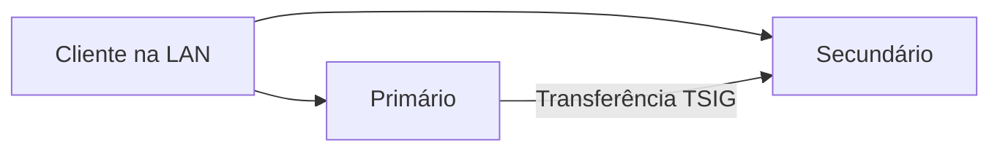

# BIND 9: primário e secundário

## 1. Visão geral

O DNS traduz nomes em endereços. Aqui, um BIND mantém a zona `lab.test` e outro
recebe uma cópia autenticada, permitindo consultar o secundário durante a falha
do primário. CoreDNS é uma alternativa; DNS não substitui um banco de dados.



Este guia usa **duas máquinas**, com um BIND em cada uma. Para usar apenas um
computador, siga o [laboratório local](laboratorio-local.md). Duas VMs no mesmo
host demonstram falha de VM; hosts distintos permitem testar falha do host.

## 2. Conceitos mínimos

| Termo | Significado |
| --- | --- |
| Zona | Conjunto de registros administrado pelo servidor |
| Autoritativo | Servidor responsável pelos dados da zona |
| Primário / secundário | Origem das alterações / cópia recebida pela rede |
| SOA e serial | Metadados e versão da zona |
| TTL | Tempo de validade de um registro em cache |
| TSIG | Autenticação das mensagens de transferência |

## 3. Pré-requisitos

- Duas máquinas na mesma rede, com Docker e Compose >= 2.20; usuário com acesso ao Docker.
- Cerca de 512 MiB de memória e 2 GiB de disco por nó, além do sistema operacional.
- IPs exclusivos e estáveis: **reserva no DHCP da rede ou IP estático na máquina**.
  Para IP estático, configure máscara, gateway e DNS e use um endereço livre,
  excluído do pool DHCP. VMs clonadas precisam de MACs distintos.

| Porta entre os nós e clientes autorizados | Uso |
| --- | --- |
| 53/UDP | Consultas e NOTIFY |
| 53/TCP | Consultas e transferência de zona |

No Windows/macOS, use Docker Desktop com contêineres Linux; no Windows, backend
WSL 2. Confira `docker version` e `docker compose version`. Para usar o Ubuntu,
habilite sua integração no Docker Desktop; não instale outro Engine nele.
Verifique o firewall do host. Se a porta 53 estiver ocupada, escolha a mesma
porta alternativa nos dois nós e use `dig -p <porta>` nas consultas.

## 4. Instalação

Obtenha o repositório nas duas máquinas. O [modelo para máquinas distintas](../../../.env.example)
fica na raiz. Na pasta `tutoriais/dns/bind9`, copie-o para `.env`:

```sh
cp ../../../.env.example .env
```

No PowerShell, use `Copy-Item ../../../.env.example .env`. Preserve um `.env`
existente antes de substituí-lo. Preencha os campos `BIND_ROLE` e `DNS_*` com
a configuração de cada nó. O modo em um computador usa outro modelo, conforme
o [guia local](laboratorio-local.md).

Identifique a interface LAN que alcança o outro nó: `ip -4 address` e `ip route`
no Linux; `Get-NetIPConfiguration` no Windows; `ifconfig` e `route -n get default`
no macOS. No Docker Desktop, use o IP LAN do host, não o IP interno do WSL/contêiner.

Preencha os dois `.env`. A tabela é **fictícia**: substitua os endereços e o CIDR
pelos do seu laboratório. Outros prefixos IPv4 também são aceitos; informe a
rede correspondente à sua máscara, sem presumir `/24`.

| Variável | Primário | Secundário |
| --- | --- | --- |
| BIND_ROLE | primario | secundario |
| DNS_PRIMARY_IP | 192.0.2.10 | 192.0.2.10 |
| DNS_SECONDARY_IP | 192.0.2.11 | 192.0.2.11 |
| DNS_BIND_ADDRESS | 192.0.2.10 | 192.0.2.11 |
| DNS_CLIENT_CIDR | 192.0.2.0/24 | 192.0.2.0/24 |
| DNS_PORT | 53 | 53 |

`DNS_CLIENT_CIDR` autoriza os clientes; `DNS_BIND_ADDRESS` deve pertencer à
máquina local. O `.env` configura o laboratório, **não atribui IP à interface**.

Em cada máquina, ainda na pasta do tutorial:

```sh
docker compose --profile ferramentas config --quiet
docker compose --profile ferramentas pull
docker compose up -d --wait --wait-timeout 120
docker compose ps -a
```

Espera-se um `dns` saudável e um `configurador` finalizado com código zero por
máquina. O configurador prepara arquivos; não é outro servidor DNS. O teste da
seção 7 confirma se o secundário recebeu a zona.

O Compose da raiz continua como atalho. Para usar a mesma configuração e projeto,
execute pela raiz `docker compose -p bind9 --env-file tutoriais/dns/bind9/.env up -d`;
repita essas opções nos demais comandos, inclusive na limpeza. Se utiliza outro
nome de projeto, mantenha-o ao trocar de pasta.

## 5. Configuração

O configurador renderiza `config/` e `zones/db.lab.test` em volumes, sem alterar
os arquivos versionados. Cada nó possui configuração, cache e dados próprios;
o secundário recebe a zona pela rede, sem montar o arquivo do primário.
As imagens têm versões e digests fixos no Compose.

`ns1` e `ns2` usam os IPs reais do `.env`. Já `app → 192.0.2.80` e
`api → 192.0.2.81` são respostas fictícias para os testes: não definem a rede
dos colegas nem representam aplicações acessíveis. Alterá-las exige ajustar
também as expectativas dos testes. As consultas externas usam encaminhadores
em `config/shared/options.conf` e precisam de Internet; a zona local não.

A chave TSIG versionada é pública e destinada ao exercício. Após alterar
registros, incremente o serial em `zones/db.lab.test` e recrie o serviço:

```sh
docker compose up -d --force-recreate --wait --wait-timeout 120
```

Se mudar um IP, atualize `DNS_PRIMARY_IP`/`DNS_SECONDARY_IP` nos dois `.env` e
`DNS_BIND_ADDRESS` no nó correspondente; revise o CIDR se mudar de rede.
Recrie os serviços em ambos e solicite no secundário uma cópia atualizada:

```sh
docker compose exec -T dns rndc -c /etc/bind/shared/rndc.conf retransfer lab.test
```

Repita o teste normal e confira `ns1`/`ns2` nos dois servidores. Atualize clientes
que usam os IPs antigos. Não é necessário apagar os volumes.

## 6. Demonstração

Siga o [roteiro de 15 minutos](roteiro-demo.md): iniciar, consultar e provocar
uma falha. Relacione a cópia da zona à replicação e sua continuidade à disponibilidade.

## 7. Verificação e teste de falhas

Com ambos os nós ativos, execute em qualquer um:

```sh
docker compose run --rm --no-deps cliente sh /testes/verificar.sh normal
docker compose logs --tail=30 dns
```

O teste confere os registros abaixo, UDP/TCP, serial igual, endereços dos NS e
recusa de AXFR sem chave. Nos logs, procure transferência concluída com TSIG.

| Consulta | Resultado esperado |
| --- | --- |
| `app.lab.test A` | `192.0.2.80` |
| `www.lab.test CNAME` | `app.lab.test` |
| `_http._tcp.lab.test SRV` | `0 5 8080 app.lab.test` |
| `lab.test NS` / `SOA` | Dois NS / mesmo serial nos dois servidores |
| `inexistente.lab.test A` | `NXDOMAIN` autoritativo |

Para consultar manualmente, sem alterar o DNS do computador:

```sh
docker compose run --rm --no-deps cliente sh -c 'dig @"$DNS_PRIMARY_IP" -p "$DNS_PORT" app.lab.test A; dig @"$DNS_SECONDARY_IP" -p "$DNS_PORT" app.lab.test A +tcp'
```

Um colega com Docker pode preencher seu `.env` e executar somente esse cliente.
No Windows, na porta 53, também pode consultar diretamente:

```powershell
$servidor = Read-Host 'IP LAN do servidor DNS'
Resolve-DnsName app.lab.test -Type A -Server $servidor -DnsOnly -NoHostsFile
Resolve-DnsName app.lab.test -Type A -Server $servidor -DnsOnly -NoHostsFile -TcpOnly
```

Repita com o outro servidor. Para outros tipos, troque nome e tipo conforme a
tabela. `Resolve-DnsName` não permite porta alternativa; nesse caso use `dig`.

Desligue somente a VM primária pelo hipervisor. No secundário:

```sh
docker compose run --rm --no-deps cliente sh /testes/verificar.sh falha
docker compose up -d --no-deps --force-recreate --wait --wait-timeout 120 dns
docker compose run --rm --no-deps cliente sh /testes/verificar.sh falha
```

O primário deve ficar indisponível e o secundário responder, inclusive após a
recriação preservando seus volumes. Religue o primário e repita `normal`.
A cópia expira após o prazo do SOA sem atualização; selecionar outro DNS
automaticamente depende do resolvedor e pode levar alguns segundos.

## 8. Problemas comuns

| Sintoma | O que conferir |
| --- | --- |
| Variável vazia ou endereço indisponível | `.env` preenchido e IP de escuta presente no host |
| Porta ocupada | Serviço existente; escolher outra porta nos dois nós |
| Consulta expira / secundário retorna SERVFAIL | CIDR autorizado, IPs, firewall TCP/UDP e logs da transferência |
| IP mudou / zona não atualizou | Atualizar ambos os `.env`, recriar e solicitar retransferência; manter IPs fixos |

## 9. Limpeza

Em cada nó, `docker compose down` encerra preservando os volumes. Inicie novamente
e repita `normal` para conferir a persistência. Para apagar os dados do laboratório:

```sh
docker compose down --volumes --remove-orphans
```

Remova somente o `.env` e regras de firewall criados para o exercício, se não
forem reutilizados. Imagens permanecem em cache; remova apenas imagens novas e
sem uso por outros projetos. Não use limpeza global como `docker system prune`.

## 10. Referências

- [BIND 9 ARM](https://bind9.readthedocs.io/en/v9.20.16/)
- [Imagem Ubuntu BIND 9](https://hub.docker.com/r/ubuntu/bind9)
- [Publicação de portas Docker](https://docs.docker.com/engine/network/port-publishing/)
- [Docker Desktop e WSL 2](https://docs.docker.com/desktop/features/wsl/)
- [Reserva DHCP](https://ubuntu.com/server/docs/explanation/networking/about-dhcp/) e [IP estático](https://ubuntu.com/server/docs/explanation/networking/configuring-networks/)
